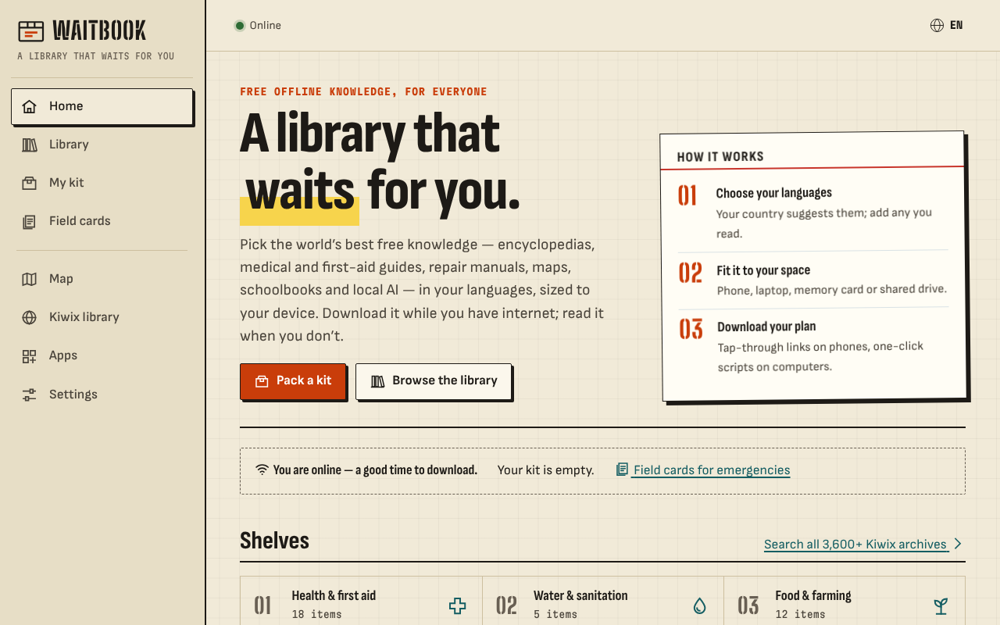
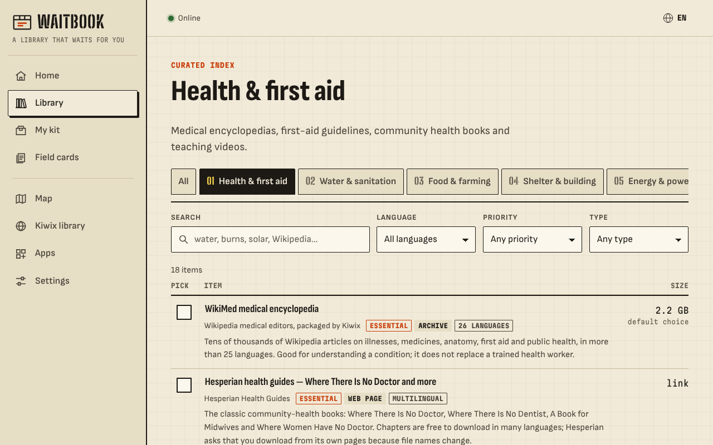

# Waitbook

**A library that waits for you.** Waitbook helps anyone, anywhere, put the world's best free offline knowledge
on their own devices — encyclopedias, medical and first-aid guides, repair manuals, country maps, schoolbooks and
local AI — in their own languages and sized to the space they have. It is an installable web app for iPhone, iPad,
Android, Mac, Windows and Linux.

Waitbook hosts nothing. It is a curated, searchable **index of direct links** to the original publishers (Kiwix,
Hesperian, WHO, IFRC, MSF, OpenStax, Hugging Face, Protomaps…). You pick shelves and languages; Waitbook gives you a
download plan that suits your device: tap-through links on phones, one resumable script on computers.



## Why it exists

Inspired by [Lastbook](https://github.com/Immortal-Protocols/lastbook) — a desktop survival library for the United
States — Waitbook takes the same idea global:

| | Lastbook | Waitbook |
|---|---|---|
| Runs on | Mac, Windows, Linux desktop app | Any browser; installs as an app on iPhone, iPad, Android, Mac, Windows, Linux, ChromeOS; also opens from a USB stick |
| Content | Its own hosted packs (7.7–388 GB) | Links to original publishers; **3,600+ Kiwix archives** searchable live |
| Languages | English, US maps | Interface in 10 languages incl. Arabic (RTL); content in hundreds — Wikipedia alone in 324 |
| Maps | US states | Every country (Kiwix map archives) + any area you choose (Protomaps) with a built-in offline viewer |
| Choosing | Small / Medium / All | Your languages × your storage budget × your priorities, or tick items one by one |

## What's inside

- **Library** — about 100 curated items on 15 shelves (health, water, food, shelter, energy, repair, disasters,
  radio, maps, encyclopedias, learning, books, computers, offline AI, apps & installers), each with publisher,
  licence, editions (with pictures / text only / summaries), languages, sizes and every link (direct, torrent,
  metalink, SHA-256).
- **Pack a kit** — country → suggested languages (Unicode CLDR) → device and space → priorities. The kit fills
  essentials first, then useful, then deep, and never exceeds the space you give it.
- **Kiwix explorer** — search the whole live Kiwix library (OPDS) by text, language and collection; offline it
  searches a saved snapshot.
- **My kit** — a ledger with a running total and exports:
  - phone/tablet checklist with tap-to-download links and ticks;
  - `waitbook-download.sh` (macOS, Linux, Android/Termux) and `waitbook-download.ps1` (Windows): resumable,
    find the newest Kiwix file at run time, verify Kiwix SHA-256 checksums, cut map extracts, write an `index.html`;
  - `links.txt` for any download manager, an `aria2` list with metalinks;
  - share link or `.json` kit file; printed manifest.
- **Field cards** — twelve offline cards for urgent situations (bleeding, burns, not breathing, dehydration,
  fever, unsafe water, sanitation, power cuts, heat and cold, after a disaster, no network, shock and grief): first
  actions, warning signs, where to read more in your kit, your own emergency numbers. Not medical advice.
- **Map** — opens any `.pmtiles` file offline (Protomaps style, a generic style for other schemas, raster imagery),
  shows your GPS position, and builds the command to cut a map of your country or the area on screen.
- **Apps** — the free readers that open each kind of file, per platform, and how to share a library over Wi-Fi.
- **Themes** — paper, dark, and a night red-light mode; text size up to 150%; strict-offline switch.



## Use it

**Online:** deploy the repository as a static site (GitHub Pages: enable Pages with "GitHub Actions" as the
source, then run the *Deploy to GitHub Pages* workflow or push to `main`). Open it once, then install it:
iPhone/iPad Safari → Share → Add to Home Screen; Android Chrome → Install app; desktop Chrome/Edge → install icon;
Mac Safari → File → Add to Dock. After the first visit it works offline.

**Locally:** `python3 -m http.server 8765` in this folder, then open http://127.0.0.1:8765/.

**From a USB stick:** copy the folder and open `index.html` directly. Everything works except installing, share
links and map labels (browsers restrict those on `file://`).

## How it stays current

Kiwix publishes new dated files monthly and keeps only the two newest, so Waitbook stores **stable book names**
(e.g. `wikipedia_fr_all_maxi`) and resolves the current file:

1. in the app, live from `opds.library.kiwix.org` when you ask (*Check sizes and newest files*);
2. in the download scripts, at the moment you run them;
3. from `data/kiwix-known.js`, a snapshot refreshed by `tools/refresh-kiwix.mjs` — weekly in CI.

Catalog patterns such as `wikipedia_{lang}_medicine_{flavour}` are expanded against the live catalog using its own
language metadata, so new languages appear automatically.

## Privacy and safety

No accounts, cookies, analytics or ads. Everything you choose stays in your browser's storage. The app contacts
only Kiwix (catalog), Hugging Face (AI file sizes) and Protomaps (map build list), only when you use those features,
never with *Strict offline* on — enforced by a Content-Security-Policy that allows nothing else. Downloads go from
the publisher straight to you. Generated scripts accept only validated `https://` links and safe file names, quote
every value, and verify checksums where publishers provide them. Field cards follow published guidance (IFRC,
WHO, Hesperian) and never give doses or procedures of their own; they were not clinically reviewed.

## Develop

No build step and no framework: plain HTML, CSS and JavaScript (classic scripts, so `file://` works).

```bash
npm test                        # unit tests + end-to-end download-script test (Node 18+)
npm run serve &                 # http://127.0.0.1:8765
npm run test:smoke -- http://127.0.0.1:8765/ --device "iPhone 15"
npm install && npm run test:a11y -- http://127.0.0.1:8765/    # axe-core audit, 4 themes/languages
node tests/e2e/offline.mjs      # service worker, file://, strict offline
npm run check:i18n              # translations match English
npm run refresh:kiwix           # update Kiwix facts from the live catalog
npm run check:links             # check every link (run where publishers are reachable)
```

| Path | What it is |
|---|---|
| `index.html`, `css/`, `js/` | The app. `js/core/` is pure logic (also used by tools and tests); `js/ui/` and `js/views/` the interface. |
| `data/catalog.js` | The curated catalog. Kiwix items name a stem or a `{lang}`/`{flavour}`/`{region}` pattern. |
| `data/kiwix-known.js`, `data/kiwix-snapshot.js` | Generated Kiwix facts (small, loaded at start) and the full catalog snapshot (loaded on demand). |
| `data/apps.js`, `data/cards.js`, `data/countries.js`, `data/world.js` | Apps and store links; field cards; country languages and boxes (CLDR, Natural Earth); world outline. |
| `i18n/` | Interface strings: en, es, fr, pt, ar, hi, zh, sw, ru, id. |
| `vendor/` | Pinned, integrity-checked third-party files (MapLibre, PMTiles, Protomaps layers, fonts, glyphs). `tools/vendor.mjs` rebuilds it. |
| `tools/` | Refresh, link check, vendoring, geo data, icons, i18n check. |
| `tests/` | Unit, end-to-end script, browser smoke, accessibility and offline tests. CI runs them on Linux, macOS and Windows and in Chromium, WebKit and Firefox. |

**Adding an item:** add an object to `data/catalog.js` (see the comments at the top), run
`node tools/refresh-kiwix.mjs` if it names Kiwix files, then `npm test`.

**Adding a language:** copy `i18n/en.js` to `i18n/xx.js`, translate the values, add the code to `UI` in
`js/core/i18n.js`, and run `npm run check:i18n`.

See [PLAN.md](PLAN.md) for the design rationale and [AUDIT.md](AUDIT.md) for the audit results.

## Licence

Waitbook's own code and text: MIT (see [LICENSE](LICENSE)). Third-party code, fonts and data keep their own
licences — see [THIRD_PARTY_NOTICES.md](THIRD_PARTY_NOTICES.md). Content you download stays under its publisher's
terms, shown on every item.
